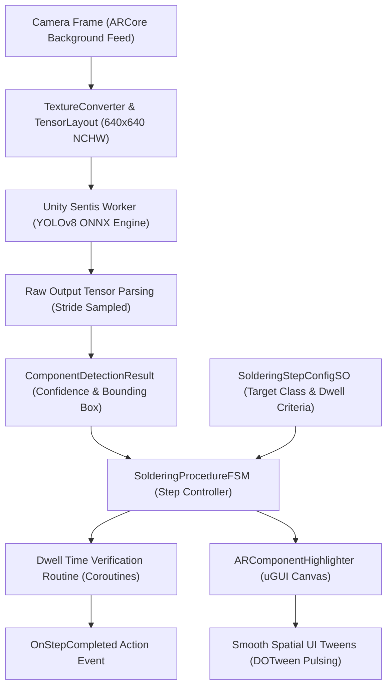

# AR Drone Flight Controller Soldering & Assembly Trainer

[](https://unity.com)
[](https://docs.microsoft.com/dotnet/csharp/)
[](https://docs.unity3d.com/Packages/com.unity.sentis@latest)
[](https://docs.unity3d.com/Packages/com.unity.xr.arfoundation@latest)
[](http://dotween.demigiant.com/)

> **Note:** В данном репозитории представлен **архитектурный срез и ядро кодовой базы на C# (`Assets/Scripts`)** для технического ревью (Code Review). Тяжелые проприетарные 3D-ассеты, коммерческие веса обученной модели и сторонние платные пакеты исключены из публичной индексации Git.

---

## 📌 О проекте

Интерактивная мобильная система дополненной реальности (AR) для пошагового обучения монтажу, пайке и контролю качества сборки полётных контроллеров для беспилотных летательных аппаратов (БПЛА).

Система распознает миниатюрные электронные компоненты (микроконтроллеры STM32, гироскопы/акселерометры MPU6000, OSD-чипы, контактные площадки питания) в реальном времени через камеру смартфона, накладывает пространственные 3D/2D-указатели и проверяет корректность выполнения каждого этапа регламента.

---

## 🏗 Архитектура пайплайна (System Pipeline)



---

## 💡 Ключевые инженерные решения

### 1. Архитектурный переход: Почему YOLOv8 + Unity Sentis вместо OpenCV for Unity / Caffe?
* **Проблема предыдущей итерации:** Изначальный прототип на базе OpenCV for Unity использовал устаревшие веса Caffe. Это приводило к просадкам FPS ниже 20 на мобильных устройствах, высокому тепловыделению и невозможности дообучать модели под кастомные платы без костылей.
* **Решение:** Построен собственный пайплайн: сбор и ручная разметка датасета микроэлектроники (CVAT) → обучение детектора YOLOv8 на PyTorch → квантование и экспорт в формат ONNX → локальный инференс через официальный движок **Unity Sentis** (Compute Shaders на GPU).
* **Результат:** Стабильная частота инференса с задержкой менее 20 мс, отсутствие внешних нативных зависимостей и полный контроль над точностью распознавания.

### 2. Полностью автономная (офлайн) архитектура
* Инференс нейросети выполняется **непосредственно на NPU/GPU смартфона**.
* Приложение не требует подключения к серверу или облачному API, что исключает сетевые задержки, экономит серверные расходы и гарантирует 100% работоспособность в полевых условиях и при нестабильной связи.

### 3. Оптимизация производительности и отказ от Race Conditions
* **Дросселирование инференса (Throttling):** Запуск тяжелой сетки сбалансирован с частотой кадров (инференс выполняется 1 раз в 2–3 кадра), освобождая ресурсы CPU под трекинг ARCore и отрисовку UI.
* **Управление асинхронностью:** В проекте используется строгий запрет на неконтролируемые фоновые потоки во избежание race conditions при обращении к объектам Unity API. Все временные сценарии валидации реализованы через `Coroutines` и `DOTween`.
* **Zero GC Alloc в Update:** Буферы детекции и списки предложений предвыделены в памяти, исключая паразитные аллокации и заикания от сборщика мусора.

---

## 📂 Структура кодовой базы

```text
Assets/Scripts/
├── CV/
│   └── SentisYoloDetector.cs       # Инициализация Sentis, обработка кадра, инференс и парсинг тензора
├── Configs/
│   └── SolderingStepConfigSO.cs    # ScriptableObject конфигурации параметров шага и целевого чипа
├── FSM/
│   └── SolderingProcedureFSM.cs    # Конечный автомат пошаговой процедуры сборки и валидации
└── UI/
    └── ARComponentHighlighter.cs   # Пространственная привязка рамок, анимация и подсказки на uGUI/DOTween
```
